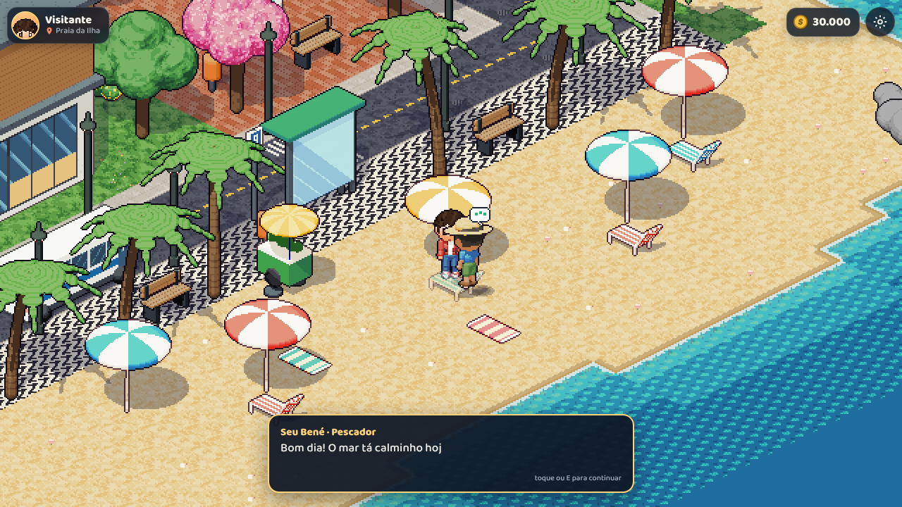

# Cidade Viva — Ilha Inicial (protótipo v0.1)

Protótipo jogável de um RPG social isométrico em **pixel art HD** (Phaser 3 + TypeScript + Vite).
Tem uma pequena ilha costeira com um bairro de três casas, praia, calçadão, praça, ponto de ônibus,
um NPC e um personagem controlável em 8 direções, com caminhada, corrida e pulo 2.5D.



## Como executar

```bash
npm install
npm run dev        # abre em http://localhost:5173 (use --host para testar no celular pela rede)
npm run build      # gera dist/ (site estático)
npm run preview    # serve o build
npm run art        # regenera todos os sprites/tiles em public/assets (≈3 s)
npm run test:e2e   # testes Playwright (com o `npm run dev` rodando)
```

## Controles

| Ação | Teclado | Celular |
|---|---|---|
| Mover | WASD / setas | Analógico (canto inferior esquerdo, proporcional à inclinação) |
| Correr | Shift (segurar) | Botão **Correr** (segurar) |
| Pular | Espaço | Botão **Pular** |
| Interagir | E | Botão **Interagir** (fica verde perto de algo) |
| Menu | Esc | Engrenagem |

## O que está implementado

- **Personagem chibi** (moletom vermelho, camiseta branca, jeans, tênis, mochila) com **8 direções reais**, sem espelhamento:
  idle com respiração (6 quadros), caminhada (8), corrida (8) e pulo em 6 fases (preparação → aterrissagem). Ver `docs/animacoes.png`.
  A cadência dos passos acompanha a velocidade real (sem "patinar"). Caminhar ↔ correr mantém a fase do passo, e ao virar o personagem gira um octante por vez.
- **Pulo 2.5D**: a altura visual `z` é separada da posição no chão. A sombra encolhe com a altura, e as colisões consideram a altura: dá para pular bancos, estacas e cercas baixas, mas não casas e árvores.
- **Mapa por tilemap isométrico** (Phaser Tilemap) em camadas: solo, areia, água, espuma, ruas e calçadas. Por cima vêm os objetos posicionados no mundo com ordenação de profundidade. Objetos grandes (casas, ônibus) usam ordenação por retângulo de chão, e objetos que cobrem o personagem ficam translúcidos.
- **Ilha**: praia com ondas e espuma animadas, brilhos no mar, pedras, conchas, guarda-sóis, espreguiçadeiras e cangas. Tem também um calçadão em ondas (pedra portuguesa), três casas (popular com caixa d'água, moderna de dois pavimentos e casa de praia com varanda), três terrenos vazios, uma praça com chafariz, ipês e bancos, ruas com faixa central e faixas de pedestres, postes, lixeiras, placas e ponto de ônibus.
- **Colisões** circulares e retangulares coerentes com o desenho (sem caixas gigantes), água e limites do mapa, além de colisores dinâmicos (ônibus, NPC).
- **Interações**: casas (ficha da residência), terrenos ("Disponível · em breve será possível comprar"), ponto de ônibus (nome, linha e **tempo real até o próximo ônibus**), NPC pescador com falas, carrinho de coco e placa de rua.
- **Vida ambiente**: palmeiras e árvores balançando, chafariz, gaivotas com sombra e brilho das luzes. Um **ônibus circular** percorre o anel de ruas pela mão direita, faz curvas, para no ponto e espera se você ficar na frente.
- **HUD**: nome, avatar, região atual, 30.000 moedas e engrenagem. **Menu de pausa**: Continuar, Configurações (nome, som, FPS, zoom, controles de toque, horário dia/pôr do sol/noite), Controles e Reiniciar demonstração.
- **Mobile**: joystick com zona morta e multitoque (joystick + Correr ao mesmo tempo), respeito às áreas seguras e bloqueio de gestos do navegador. Renderiza em pixels físicos (DPR) com **zoom inteiro** de câmera para manter a pixel art nítida.
- **Áudio** procedural (Web Audio): mar ambiente, passos, pulo e UI. Não usa arquivos de som.

## Arquitetura

```
art/                 pipeline de produção dos assets (roda no Node, gera PNG/JSON)
  rt.ts              mini-renderizador ortográfico: primitivas 3D → pixel art (cel shading, sel-out, sombras)
  character.ts       rig do personagem, poses procedurais e pintura do rosto pixel a pixel
  objects.ts         casas, vegetação, mobiliário urbano, ônibus (8 direções)
  tiles.ts           tiles isométricos 32×16 sem emendas (padrões periódicos)
  build.ts           monta tileset, atlas (com âncoras) e spritesheets
src/
  config.ts          velocidades, física, animação e câmera (valores reutilizáveis)
  core/              iso.ts (projeção), events.ts (barramento jogo ↔ UI)
  world/             MapData (dados do mapa), World (render do tilemap/objetos), Ambient
  entities/          Actor (modelo lógico), PlayerController, CharacterView, Npc, Bus
  systems/           InputController, AnimationController, CameraController, CollisionSystem, InteractionSystem
  ui/Ui.ts           HUD, joystick, botões, painéis, diálogo e menu (DOM)
  scenes/            BootScene (carregamento), GameScene (orquestração)
tests/e2e.mjs        31 verificações automatizadas (desktop + celular)
```

A lógica fica separada da renderização: `Actor`/`PlayerController` não conhecem sprites. Os dados do mapa (`MapData`) ficam separados das regras de interação (`InteractionSystem`). Terrenos, casas e interações são listas de dados, prontas para receber donos, compra e participantes no futuro.

## Assets e licenças

Todos os gráficos são **originais**, gerados pelo pipeline em `art/` ("modelagem 3D simples → render ortográfico → pixel art"),
equivalente ao fluxo Blender → sprite sugerido, mas reprodutível com `npm run art`. Não há filtro de pixelização sobre imagens realistas:
cada texel é calculado diretamente com rampas de cor quantizadas e contorno seletivo. Avaliei Kenney, OpenGameArt, itch.io e Quaternius
(CC0 / licenças livres), mas não incorporei nenhum asset de terceiros para manter um estilo único e evitar mistura de licenças.
Fonte da interface: Baloo 2 (Google Fonts, SIL Open Font License). Dependência: Phaser 3.80.1 (MIT).

## Testes (resultado atual)

`npm run test:e2e` → **31/31 verificações aprovadas**: início, mapa, personagem, caminhada, corrida, parada, câmera, pulo,
aterrissagem, colisão com casa, mar e limites, pulo sobre obstáculo baixo, interações (terreno, casa, ponto, NPC), ônibus,
menu (Esc, configurações, controles, reiniciar, continuar), digitação sem conflito com o teclado de jogo, controles de toque,
joystick proporcional, multitoque joystick + correr, retorno do joystick, botões Pular e Interagir, menu por toque,
interface ocupando 13,7% da tela, e nenhum erro no console. Capturas em `docs/screenshots/`.

## Limitações conhecidas

- O FPS foi medido somente em navegador headless com GPU emulada por software (~26 FPS, que subestima o real). Ainda falta medir em aparelhos reais. O jogo exibe um contador de FPS (menu → Configurações).
- O rosto do personagem é pintado proceduralmente; ainda não é uma ilustração 100% manual quadro a quadro.
- A orla da ilha segue a grade de tiles (contorno em "degraus"), e não há transição suave de profundidade entre os tons do mar.
- A ordenação de profundidade de objetos grandes usa uma heurística por retângulo e pode falhar em sobreposições raras entre dois objetos grandes.
- O ônibus é decorativo (não há embarque), e o NPC tem rota fixa simples.
- Economia, compra de terrenos e perfis são apenas visuais nesta versão. A arquitetura está preparada, mas os sistemas não foram implementados.
