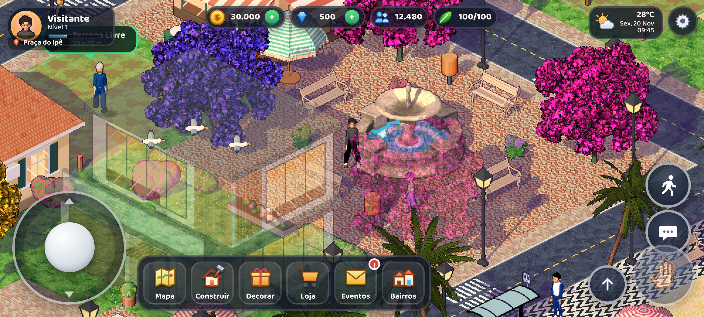

# Cidade Viva — Ilha Inicial (protótipo v0.2)

Protótipo jogável de um RPG social isométrico em **pixel art HD**, feito com Phaser 3, TypeScript e Vite. Uma ilha costeira brasileira ao pôr do sol tem:

- calçadão em ondas, praia, praça com chafariz e ipês, café, três casas e três terrenos livres;
- píer com roda-gigante, farol, barcos e ilha com vilarejo ao fundo;
- ônibus circular e seis moradores andando pela cidade;
- um personagem controlável em 8 direções, que anda, corre e pula (2.5D).



## Como executar

```bash
npm install
npm run dev        # http://localhost:5173 (use --host para testar no celular pela rede)
npm run build      # gera dist/ (site estático)
npm run preview    # serve o build
npm run test:e2e   # 31 verificações com Playwright (com o `npm run dev` rodando)
```

### Regenerar a arte (opcional)

Os sprites prontos já estão em `public/assets/`. Para gerar de novo:

```bash
./tools/fetch-models.sh                 # baixa os modelos gratuitos do BlenderKit (cenário)
npm run art                             # tiles + objetos + personagens (~4 min)
npx tsx art/build.ts objects            # só objetos  ·  tiles  ·  chars
```

Os modelos de personagem são baixados com `python3 tools/bk-download.py "<nome>" <id> tools/models/char_N.glb`. Os ids estão em `CREDITS.md`.

## Controles

| Ação | Teclado | Celular |
|---|---|---|
| Mover | WASD / setas | Analógico (proporcional à inclinação) |
| Correr | Shift (segurar) | Botão de corrida (segurar) |
| Pular | Espaço | Botão ↑ |
| Interagir | E | Botão de mão (fica verde perto de algo) |
| Menu | Esc | Engrenagem |

O menu lateral tem **Mapa**, **Construir** (catálogo de casas com preços), **Decorar**, **Loja**, **Eventos** e **Bairros**. O botão de chat mostra frases rápidas em um balão.

## Pipeline de arte: modelos 3D → pixel art HD

O fluxo segue o "Blender → sprite" pedido no briefing, mas roda inteiro em Node e é reproduzível:

1. **Modelos gratuitos do BlenderKit** (palmeiras, ipês, flores, postes, bancos, chafariz, farol, barcos, guarda-sóis, espreguiçadeiras, ponto de ônibus e personagens) chegam como GLB com compressão Draco e texturas WebP. `art/mesh.ts` lê esses arquivos com glTF-Transform e sharp.
2. **Personagens com esqueleto Rigify** (`art/skin.ts`):
   - Recebem pose procedural (idle, caminhada, corrida e pulo em 6 fases) guiada pela direção dos ossos.
   - A malha é deformada por skinning linear.
   - A pele que fica sob a roupa e as malhas com bind inconsistente são descartadas automaticamente.
3. **Renderizador HD** (`art/hd.ts`):
   - Câmera ortográfica dimétrica 2:1 com supersampling 3×3.
   - Luz de fim de tarde em faixas (cel shading), com sol quente e sombras arroxeadas.
   - Sombras projetadas com teste de alfa, então as folhas geram sombra rendada.
   - Paleta reduzida por k-means, contorno seletivo e linhas internas.
   - Grade espacial para acelerar.
4. **Cenário procedural** (`art/env.ts`): casas brasileiras com janelas acesas, telhas capa-canal, varandas, caixa d'água e piscina. Também café com toldo e letreiro, roda-gigante animada (8 quadros), píer, ilha com vilarejo, ônibus em 8 direções e gaivotas.
5. **Tiles 64×32** (`art/tiles.ts`): grama com flores, areia com conchas, mar animado com brilhos dourados, espuma, asfalto, faixas, calçada de pedra rosada, calçadão em ondas e piso da praça.

Os créditos e licenças de cada modelo estão em [`CREDITS.md`](CREDITS.md). O jogo não distribui os modelos 3D, apenas os sprites renderizados.

## Arquitetura do jogo

```
src/
  config.ts          velocidades, física, animação, câmera e economia (valores reutilizáveis)
  core/              iso.ts (projeção), events.ts (barramento jogo ↔ UI)
  world/             MapData (dados do mapa), World (tilemap + objetos + bordas dos terrenos), Ambient
  entities/          Actor (modelo lógico), PlayerController, CharacterView, Npc, Bus
  systems/           InputController, AnimationController, CameraController, CollisionSystem, InteractionSystem
  ui/                Ui.ts (HUD, catálogo, joystick, painéis, minimapa, menu) e icons.ts (ícones ilustrados)
  scenes/            BootScene (carregamento), GameScene (orquestração)
art/                 pipeline de produção dos assets (Node)
tools/               busca, download e inspeção de modelos do BlenderKit e créditos
tests/e2e.mjs        verificações automatizadas (desktop + celular)
```

A lógica fica separada da renderização: `Actor` e `PlayerController` não conhecem sprites. O mapa (`MapData`) fica separado das regras de interação (`InteractionSystem`). Terrenos, casas, NPCs e interações são dados, prontos para ganhar donos, compra e participantes no futuro.

## Testes

`npm run test:e2e` → **31/31 verificações aprovadas**:
- início e mapa em 6 camadas;
- caminhada, corrida, parada, câmera, pulo e aterrissagem;
- colisões com casa, mar e limites, e pulo sobre o banco correndo;
- interações com terreno, casa, ponto de ônibus e NPC;
- ônibus circulando;
- menu completo e digitação sem conflito com o teclado de jogo;
- joystick proporcional, multitoque, retorno do joystick, botões de pular, interagir e engrenagem;
- interface ocupando cerca de 21% da tela;
- nenhum erro no console.

As capturas ficam em `docs/screenshots/`.

## Limitações conhecidas

- O FPS só foi medido em navegador headless com renderização por software (cerca de 17 FPS, abaixo do que se espera em aparelhos reais). Ainda falta medir em celulares de verdade; há um contador em Configurações → Mostrar FPS.
- O atlas de objetos tem uma página de 4089×2502. Aparelhos muito antigos, com limite de textura de 2048, não suportariam.
- As animações dos personagens são procedurais, não capturas de movimento. Os NPCs têm apenas idle e caminhada.
- A orla segue a grade de tiles, com contorno "em degraus".
- Compra de terrenos, economia, eventos, loja e bairros são apenas visuais nesta versão. O catálogo de construção mostra os itens, mas a compra aparece como "em breve".
